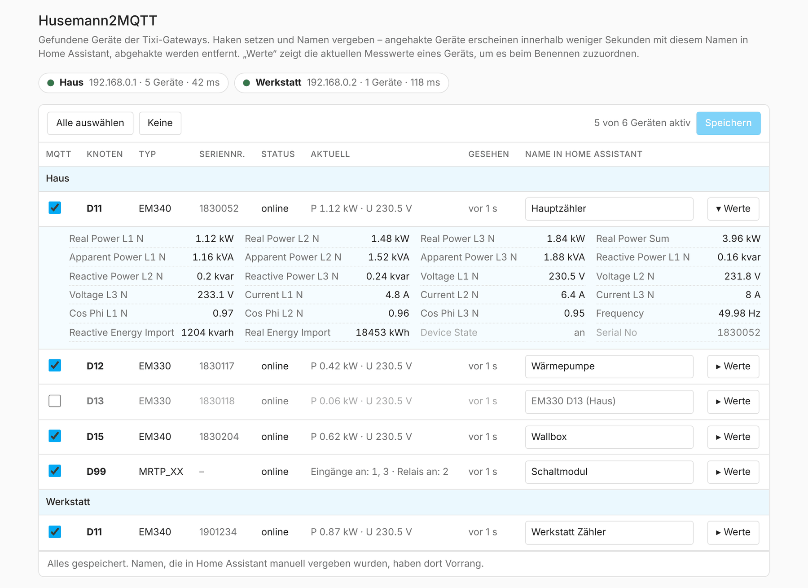
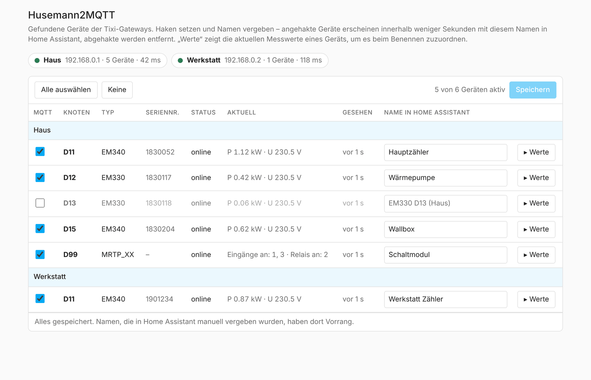
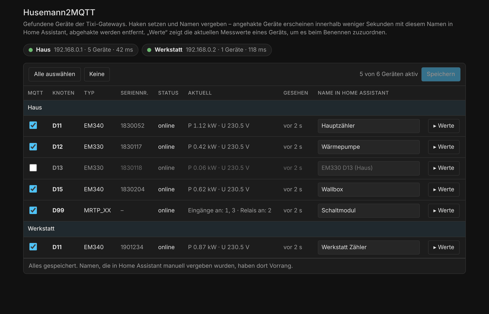
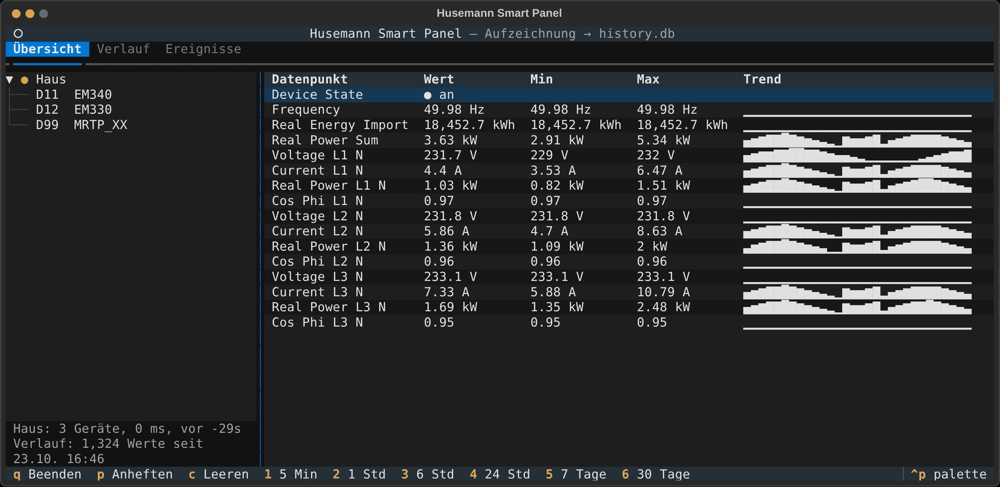
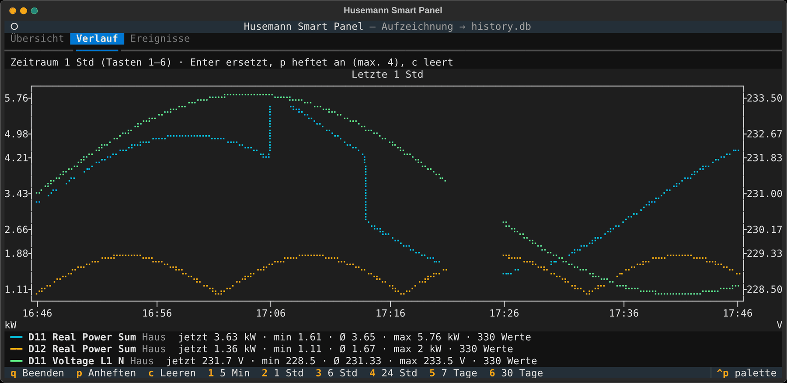

# Husemann2MQTT

Home-Assistant-Add-on, das ein **Husemann Smart Panel** (Tixi.Gate-Datenlogger
mit SpiderControl-HMI) über die **TiXML-HTTP-API** ausliest und alle Zähler und
I/O-Module per **MQTT-Discovery** in Home Assistant anlegt.

Keine Modbus-Verkabelung, kein Login nötig: Der Logger stellt die Live-Werte
aller am Bus konfigurierten Geräte als XML bereit. Das Add-on pollt sie, zeigt
die gefundenen Geräte in der HA-Seitenleiste und legt die ausgewählten mit dem
vergebenen Namen automatisch als Sensoren an.

<p align="center">
  
</p>

## So funktioniert es

```
Husemann Smart Panel            Home Assistant
┌───────────────────┐  TiXML   ┌──────────────────┐  MQTT   ┌─────────────┐
│ Tixi.Gate (HE653) │ ───────▶ │ Husemann2MQTT    │ ──────▶ │ Mosquitto   │──▶ Sensoren,
│ Zähler / I/O      │  HTTP    │ Add-on + Sidebar │ Discov. │ MQTT-Broker │    Energie-Dashboard
└───────────────────┘ :8080    └──────────────────┘         └─────────────┘
```

## Installation (über GitHub in Home Assistant OS)

1. In Home Assistant: **Einstellungen → Add-ons → Add-on Store**.
2. Oben rechts **⋮ → Repositories**.
3. URL dieses Repos eintragen:
   `https://github.com/Gimtiese/Husemann2MQTT`
4. Das Add-on **Husemann2MQTT** erscheint im Store → **Installieren**.
5. Unter **Konfiguration** die Gateways (und ggf. MQTT) einstellen, dann **Starten**.
6. **Husemann2MQTT** in der Seitenleiste öffnen, Geräte anhaken, Namen vergeben, **Speichern**.

> Voraussetzung: Ein MQTT-Broker in HA (z. B. das **Mosquitto**-Add-on) und die
> **MQTT-Integration**. Das Add-on nutzt dessen Zugangsdaten automatisch; ein
> externer Broker lässt sich alternativ in den Optionen eintragen.

## Geräte auswählen und benennen

Nach dem Start öffnet **Husemann2MQTT** in der Seitenleiste eine Übersicht aller
gefundenen Geräte: Haken setzen, Namen vergeben, **Speichern** – fertig. Mit
**Werte** lassen sich die Live-Messwerte eines Geräts aufklappen, um z. B.
herauszufinden, welcher Zähler die Wärmepumpe ist.

| Hell | Dunkel |
|------|--------|
|  |  |

## Was wird erkannt

Jeder Busteilnehmer des Loggers (`D11`, `D12`, …) wird automatisch zu einem
HA-Gerät, der Gerätetyp kommt aus der Panel-Konfiguration. Getestet mit:

| Gerätetyp | Hersteller | Inhalt |
|-----------|------------|--------|
| EM330 / EM340 | Carlo Gavazzi | 3-Phasen-Energiezähler (U, I, P, Q, S, cos φ, f, kWh) |
| MRTP I/O-Modul | Tixi | Digitale Eingänge + Relais (nur lesen) |

Andere Zähler, die der Logger über Modbus bereitstellt, werden ebenfalls
angelegt; Einheiten werden per Namensregel aus den Datenpunktnamen abgeleitet.
Details zum Datenmodell: [`docs/DATAMODEL.md`](docs/DATAMODEL.md).

## Terminal-UI (ohne Home Assistant)

Für Exploration und Verläufe direkt am Rechner: [`tui/`](tui/README.md) –
live Übersicht, Diagramme und Ereignisse, mit lokaler Aufzeichnung (SQLite).

| Übersicht | Verlauf |
|-----------|---------|
|  |  |

## Konfiguration (Auszug)

```yaml
gateways:
  - name: Gateway 1
    host: 192.168.0.1
    port: 8080
poll_interval: 10          # Sekunden
base_topic: husemann
discovery_prefix: homeassistant
auto_enable_new_devices: false   # true = neue Geräte sofort publizieren
include_devices: []        # Vorgabe für neue Geräte; leer = alle, sonst z. B. ["D11","EM340"]
exclude_devices: []        # z. B. ["D99"]
device_names:              # Vorgabe-Namen für neue Geräte (Seitenleiste hat Vorrang)
  - node: D11
    name: Hauptzähler
mqtt:                      # leer lassen, wenn HA-Mosquitto genutzt wird
  host: ""
  port: 1883
  username: ""
  password: ""
```

Alle Optionen: [`husemann2mqtt/DOCS.md`](husemann2mqtt/DOCS.md).

## Fehlersuche

| Symptom | Ursache / Abhilfe |
|---------|-------------------|
| Keine Geräte in der Seitenleiste | Gateway-`host`/`port` prüfen; im Browser `http://<host>:8080/System/Properties/Process/` muss XML liefern. Das Add-on-Log zeigt Verbindungsfehler. |
| Gerät angehakt, aber nicht in HA | MQTT-Integration und Broker laufen? Das Add-on nutzt sonst die Option `mqtt`. `discovery_prefix` muss zu HA passen. |
| Gerät ohne Messwerte | Am Bus konfiguriert, aber nicht erreichbar (`DeviceState = 0`) – Verkabelung/Adresse am Panel prüfen. |
| Leistungswerte wirken unplausibel | kW/kVA-Skalierung einmal gegen die Panel-Anzeige prüfen, siehe [`DOCS.md`](husemann2mqtt/DOCS.md#hinweise). |
| Seitenleiste lädt nicht | Die Oberfläche ist nur über Home Assistant (Ingress) erreichbar, nicht direkt per IP:8099. |

## Status

v0.3.1 – liest beliebig viele Gateways, Geräte werden in der Seitenleiste
ausgewählt und benannt, Publikation read-only nach MQTT. Schalten der Relais
ist bewusst (noch) nicht aktiv.

## Entwicklung

```bash
python3 -m venv .venv && .venv/bin/pip install -r requirements-dev.txt
.venv/bin/ruff check . && .venv/bin/pytest
```

Die Weboberfläche lässt sich ohne Home Assistant testen (eine `options.json`
nach dem Muster aus `husemann2mqtt/DOCS.md` anlegen, MQTT-Broker eintragen):

```bash
cd husemann2mqtt
H2M_OPTIONS=../options.json H2M_REGISTRY=../devices.json H2M_ALLOW_ANY_CLIENT=1 \
  ../.venv/bin/python -m app.main        # dann http://localhost:8099 öffnen
```

## Lizenz

MIT – siehe [LICENSE](LICENSE).
